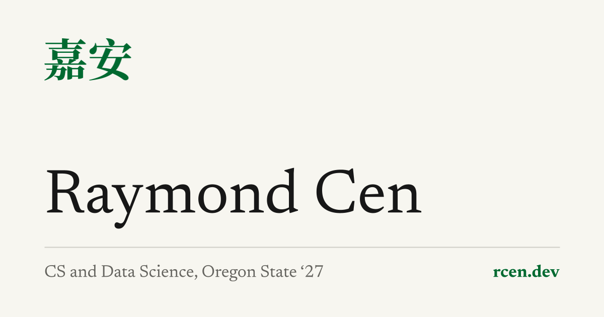

# rcen.dev

Personal portfolio for Raymond Cen, live at **[rcen.dev](https://rcen.dev)**.



**Stack:** Astro 7, Tailwind CSS v4, TypeScript, Cloudflare Workers

## Run locally

Requires Node 22.12 or later.

```
npm install
npm run dev
```

Open http://localhost:4321.

| Command | Does |
|---|---|
| `npm run build` | Build the site to `dist/` |
| `npm run preview` | Serve the built site |
| `npx astro check` | Type-check pages and content |
| `npm run full-prev` | Build, then run a local version of the full deployed site, Worker included, at http://127.0.0.1:8787 |

## Deploy

Hosted on Cloudflare Workers at rcen.dev. Pushes to `main` build and deploy through Cloudflare Workers Builds. Other branches get preview URLs.

## Design

Decisions, tokens and behavior are documented in [`docs/design.md`](docs/design.md).

## License

Code is MIT licensed. Site content, photos and resume: all rights reserved.
